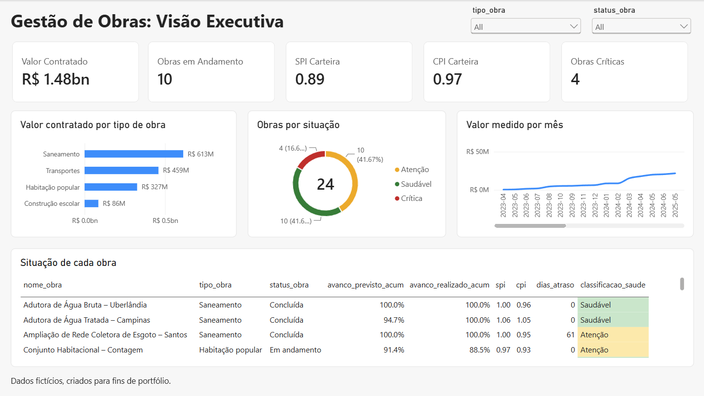
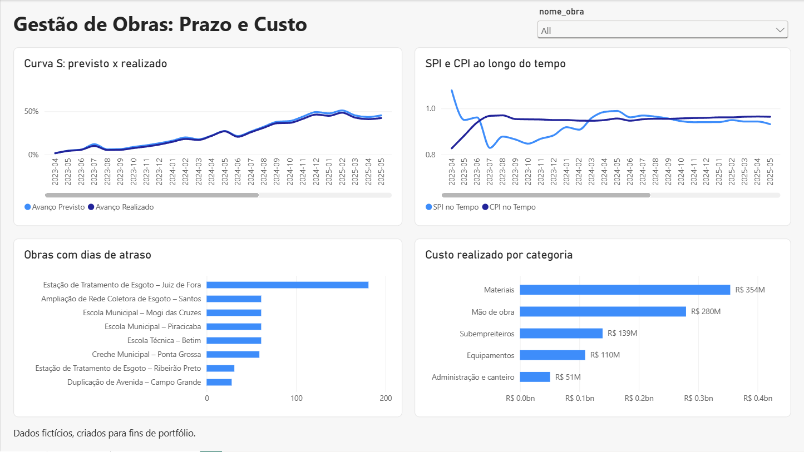
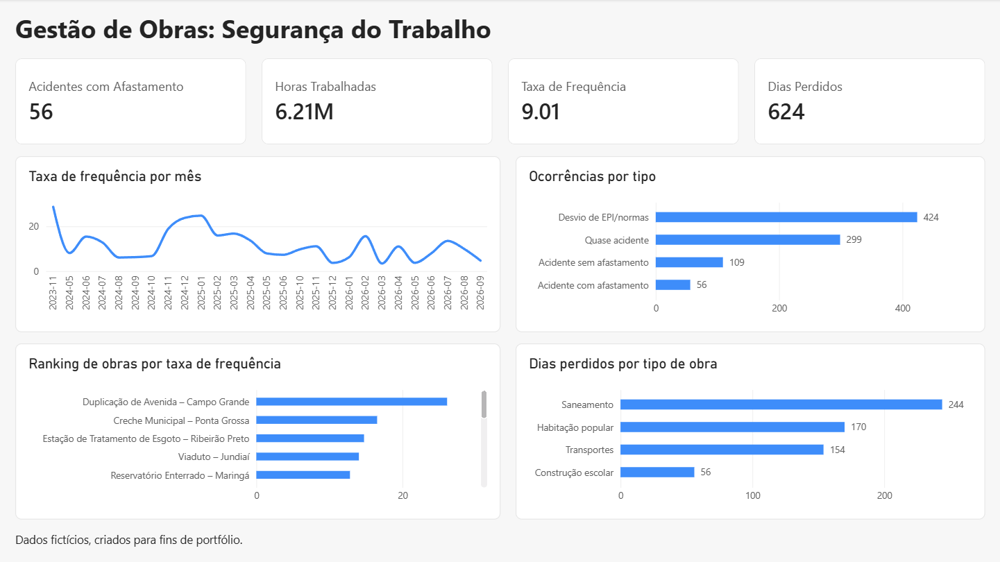

# Painel de Gestão de Obras: SQL + Python + Power BI

Projeto de portfólio de análise de dados (BI): acompanhamento de uma carteira de obras de engenharia (saneamento, habitação popular, construção escolar e transportes), respondendo perguntas de **prazo, custo e segurança do trabalho**.

> **Dados fictícios.** Todos os dados foram gerados por simulação (semente fixa), apenas para fins de portfólio. Não representam contratos, valores ou indicadores reais de nenhuma empresa.

## O problema que o projeto resolve

Quem gerencia uma carteira de obras precisa saber, antes que vire prejuízo, **quais obras estão atrasadas, quais estão gastando mais do que o avanço justifica e onde há risco de segurança**. Na prática, essas informações costumam estar em fontes separadas (medições de avanço, custos, ocorrências de segurança), e cada pessoa calcula os indicadores à sua maneira.

Este projeto mostra como organizar isso de ponta a ponta: **dados confiáveis no banco, indicadores calculados em um único lugar e um painel que responde às perguntas da gestão**.

## O que o projeto entrega

- Um **banco PostgreSQL** (em Docker) com modelo estrela, validado e pronto para consulta.
- **Indicadores padronizados** de gestão de obras: SPI (prazo), CPI (custo), classificação de saúde de cada obra e taxa de frequência de acidentes.
- **9 análises em SQL** que respondem perguntas de negócio.
- Um **dashboard em Power BI de 3 páginas** (visão executiva, prazo e custo, segurança do trabalho), com filtros e semáforo de risco.
- Um **ambiente reproduzível**: qualquer pessoa sobe o projeto do zero com Docker e alguns comandos.

## Dashboard

**Visão executiva**


**Prazo e custo**


**Segurança do trabalho**


## Principais conclusões

- A carteira tem **24 obras e R$ 1,48 bi contratados**. As 10 obras em andamento somam R$ 757 mi (51% da carteira).
- **SPI da carteira de 0,89**: o avanço físico executado está cerca de 11% abaixo do previsto. O **CPI de 0,97** mostra que o custo está próximo do esperado para o que foi entregue. O problema principal é **prazo**, e não custo.
- **4 obras críticas** (2 delas paralisadas). A obra de urbanização em Diadema, por exemplo, parou em cerca de 25% de avanço, contra cerca de 96% previstos.
- Comparar só "orçado x realizado" engana: obra atrasada gasta menos no período. O Corredor de Ônibus de São Bernardo tem **CPI 1,02 (custo ok) mas SPI 0,84 (atrasado)**.
- Em saneamento, o custo estoura em relação ao avanço principalmente em **subempreiteiros (+5,5%)**, materiais (+4,4%) e mão de obra (+4,1%).
- **Materiais** representam 37,9% do custo realizado total.
- Segurança: **56 acidentes com afastamento e 624 dias perdidos**, taxa de frequência de **9,01** por milhão de horas trabalhadas. Os desvios de EPI/normas são o tipo de ocorrência mais comum (424 de 888 registros).

## O que foi feito em cada ferramenta

### Python: gerar, validar e carregar os dados
- `gerar_dados.py` simula uma carteira de 24 obras de 4 tipos (curva S de avanço previsto, ritmo de execução por obra, pressão de custo, 2 obras paralisadas, custos por categoria e ocorrências de segurança). A semente é fixa, então o resultado é sempre o mesmo.
- `carregar_postgres.py` lê os arquivos e **valida a qualidade antes de carregar**: nulos, avanço fora do intervalo de 0 a 100%, medição duplicada, avanço que diminui de um mês para o outro e referências a obras inexistentes. Se uma checagem falha, nada é carregado.
- A carga é feita **em transação**: ou entra tudo, ou não entra nada. Assim o banco nunca fica pela metade.

### SQL: modelagem, regras de negócio e análise
- **Modelo estrela** (`01_schema.sql`): 3 dimensões e 3 fatos, com chaves primárias e estrangeiras, restrições (`CHECK`) e índices.
- **Views com as regras de negócio** (`02_views.sql`):
  - `vw_earned_value`: calcula PV, EV, AC, SPI e CPI mês a mês, com valores acumulados por obra (window functions).
  - `vw_obra_situacao_atual`: o retrato mais recente de cada obra, com dias de atraso e a classificação **Saudável, Atenção ou Crítica**.
  - `vw_seguranca_mensal`: ocorrências e horas trabalhadas por mês.
- **9 análises** (`03_analises.sql`) com CTE, `RANK`, `LAG`, `NTILE`, médias móveis e `FILTER`: ranking de obras atrasadas, onde o custo estoura em relação ao avanço, obras em risco, taxa de frequência, alerta de 3 meses seguidos abaixo do previsto, entre outras.

### Power BI: modelo semântico e dashboard
- Conexão ao PostgreSQL em modo **Importar**, com **8 relacionamentos** entre dimensões e fatos.
- **13 medidas DAX** em uma tabela dedicada (`_Medidas`): valor contratado, SPI e CPI da carteira, obras críticas, taxa de frequência, dias perdidos e outras.
- **3 páginas**: visão executiva (cartões, gráficos e tabela com semáforo), prazo e custo (curva S, SPI e CPI ao longo do tempo, dias de atraso, custo por categoria) e segurança do trabalho.
- **Filtros interativos** por tipo de obra, status e obra, que atualizam todos os visuais da página.

## Como isso ajuda uma equipe de analistas

| Problema comum | Como o projeto trata |
|---|---|
| Cada analista calcula SPI/CPI de um jeito e os números não batem | As regras ficam **nas views do SQL**, uma única fonte de verdade. Power BI, Excel ou Python leem os mesmos números |
| Mudar um critério (ex.: o que é obra "crítica") exige mexer em vários relatórios | A regra fica em **um lugar só**; os relatórios herdam a mudança |
| Dados ruins chegam ao painel e ninguém percebe | **Validações automáticas** barram o problema antes da carga |
| Um analista novo demora para montar o ambiente | **Docker Compose** e `requirements.txt`: o ambiente sobe do zero em poucos comandos |
| Os relatórios dependem de planilhas manuais | O fluxo é **repetível**: gerar/extrair, validar, carregar e atualizar o painel |
| Gestão precisa responder dúvidas na hora | O dashboard tem **filtros e semáforo**, sem pedir uma nova consulta ao analista |

> **Adaptação para dados reais:** os dados aqui são simulados, mas a estrutura se mantém. Troca-se o `gerar_dados.py` por uma etapa de extração (ERP, planilhas de medição, sistema de segurança), e o restante (validação, banco, views e painel) continua valendo.

## Arquitetura

```
gerar_dados.py ──► CSVs ──► carregar_postgres.py ──► PostgreSQL (Docker) ──► Power BI
   (Python)                 (valida e carrega)        tabelas + views (SQL)    (modelo + DAX)
```

| Camada | Ferramenta | O que faz |
|---|---|---|
| Geração e ETL | Python (pandas, SQLAlchemy) | Simula os dados, valida a qualidade e carrega no banco em transação |
| Armazenamento | PostgreSQL 16 no Docker | Modelo estrela e views com os indicadores |
| Análise | SQL | 9 consultas com CTE, window functions, FILTER e NTILE |
| Visualização | Power BI | Modelo, medidas DAX e dashboard de 3 páginas |

## Estrutura do repositório

```
gestao-obras-bi/
├── docker-compose.yml
├── .env.example
├── requirements.txt
├── python/
│   ├── gerar_dados.py          # gera os CSVs fictícios
│   └── carregar_postgres.py    # valida e carrega no PostgreSQL
├── sql/
│   ├── 01_schema.sql           # tabelas (modelo estrela)
│   ├── 02_views.sql            # views com SPI, CPI e classificação de saúde
│   └── 03_analises.sql         # consultas de análise (Q1 a Q9)
├── dados/                      # CSVs gerados (não versionados)
└── powerbi/
    ├── gestao-obras.pbix
    └── prints/
```

## Como executar

Pré-requisitos: Docker Desktop, Python 3.10+ e Power BI Desktop (Windows).

```powershell
# 1. Credenciais
copy .env.example .env

# 2. Subir o PostgreSQL
docker compose up -d

# 3. Criar tabelas e views
docker cp sql\01_schema.sql obras_bi_postgres:/tmp/01_schema.sql
docker exec obras_bi_postgres psql -U analista -d obras_bi -f /tmp/01_schema.sql
docker cp sql\02_views.sql obras_bi_postgres:/tmp/02_views.sql
docker exec obras_bi_postgres psql -U analista -d obras_bi -f /tmp/02_views.sql

# 4. Ambiente Python
python -m venv .venv
.venv\Scripts\activate
pip install -r requirements.txt

# 5. Gerar os dados e carregar no banco
python python\gerar_dados.py
python python\carregar_postgres.py
```

Depois, abra `powerbi/gestao-obras.pbix`. Para atualizar os dados, conecte em `localhost:5432`, banco `obras_bi`, com as credenciais do seu `.env`.

## Modelo de dados (estrela)

- **Dimensões:** `dim_obra`, `dim_tempo` (calendário diário), `dim_categoria_custo`
- **Fatos:** `fato_medicao` (avanço físico previsto x realizado, valor medido, horas), `fato_custo` (orçado x realizado por categoria), `fato_seguranca` (ocorrências)
- **Views:** `vw_earned_value` (evolução mensal com SPI e CPI), `vw_obra_situacao_atual` (retrato atual de cada obra), `vw_seguranca_mensal`

### Indicadores de Earned Value

| Sigla | Fórmula | Leitura |
|---|---|---|
| PV | avanço previsto x orçamento de custo | quanto deveria ter sido executado |
| EV | avanço realizado x orçamento de custo | quanto foi executado, em valor |
| AC | custo realizado acumulado | quanto custou |
| **SPI** | EV / PV | abaixo de 1 = obra atrasada |
| **CPI** | EV / AC | abaixo de 1 = custo acima do esperado para o avanço |

Classificação de saúde (view `vw_obra_situacao_atual`): **Crítica** se SPI < 0,85 ou CPI < 0,90; **Atenção** se SPI < 0,95 ou CPI < 0,95; **Saudável** nos demais casos.

**Taxa de frequência** = acidentes com afastamento x 1.000.000 / horas trabalhadas.

## Perguntas de negócio (SQL)

| # | Pergunta | Técnica |
|---|---|---|
| Q1 | Como está a carteira por status? | `GROUP BY`, `SUM() OVER ()` |
| Q2 | Qual tipo de obra concentra mais valor? | `RANK()` |
| Q3 | Quais as 10 obras mais atrasadas? | view + `RANK()` |
| Q4 | Como evolui o faturamento mês a mês? | CTE, `LAG`, média móvel |
| Q5 | Onde o custo estoura em relação ao avanço? | CTE, `JOIN` |
| Q6 | Quais obras estão em risco? | `NTILE` |
| Q7 | Qual a taxa de frequência por obra? | CTE, `FILTER`, `RANK()` |
| Q8 | Quais obras ficaram 3 meses seguidos abaixo do previsto? | janela móvel |
| Q9 | Para onde vai o dinheiro? | participação percentual |

## Decisões de projeto

- **Regras de negócio no SQL** (views com SPI, CPI e classificação) e **medidas de apresentação no DAX**, para o cálculo ter uma única fonte de verdade.
- **CPI em vez de "orçado x realizado"**, porque compara o custo com o avanço entregue.
- **Validação antes da carga** (nulos, avanço entre 0 e 1, duplicidades, integridade referencial) e **carga em transação**.
- **Ambiente reproduzível** com Docker Compose.

## Possíveis evoluções

- Agendamento do ETL e carga incremental
- Previsão de término (EAC = orçamento / CPI)
- Atualização automática do relatório no Power BI Service